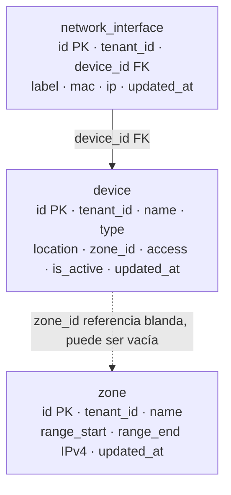

# device_manager — Diagrama de Base de Datos

- `device.type`: `computer` / `printer` / `server` / `other`.
- `device.access`: `local` / `internet_filtered` / `internet` (nombres de `webtyp.com/network`).
- `network_interface.mac`: opcional, canónica, única por tenant cuando está presente; se rechazan MACs aleatorias.
- `network_interface.ip`: única por tenant; autoasignada desde la zona del equipo cuando está vacía.
- Las reglas de unicidad y rangos se aplican en la capa de servicio, por `tenant_id`, no como restricciones de base de datos.
